# Saath: processes, user flows and backend data

Every diagram below is Mermaid. They render on GitHub and in VS Code (with a Mermaid preview). Each one is also saved on its own in `docs/diagrams/` as a `.mmd` file, for mermaid.live or a Figma plugin.

Contents

1. System overview
2. First launch and sign-up (all three doors)
3. Account sign-in
4. Patient: a day on the Today screen
5. The safety alert process
6. Adding someone to the circle (invite)
7. A doctor adds a patient with a card
8. Who sees an event: the privacy dial
9. Push notification to the circle
10. Doctor publishes a care plan
11. Sugar readings shared with a doctor
12. AI suggestion cards
13. AI helper chat
14. ASHA household visit
15. Backend data: tables and links
16. Who can read and write each table

Status, stated plainly: the rules, the alert logic and the screens are tested; the invite, doctor, readings and push flows (6, 7, 9, 10, 11) are built and tested against a fake server but have not been run with two real phones. See `docs/USER_MANUAL.md` and the README table.

---

## 1. System overview

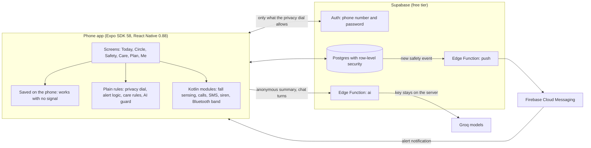

---

## 2. First launch and sign-up (all three doors)

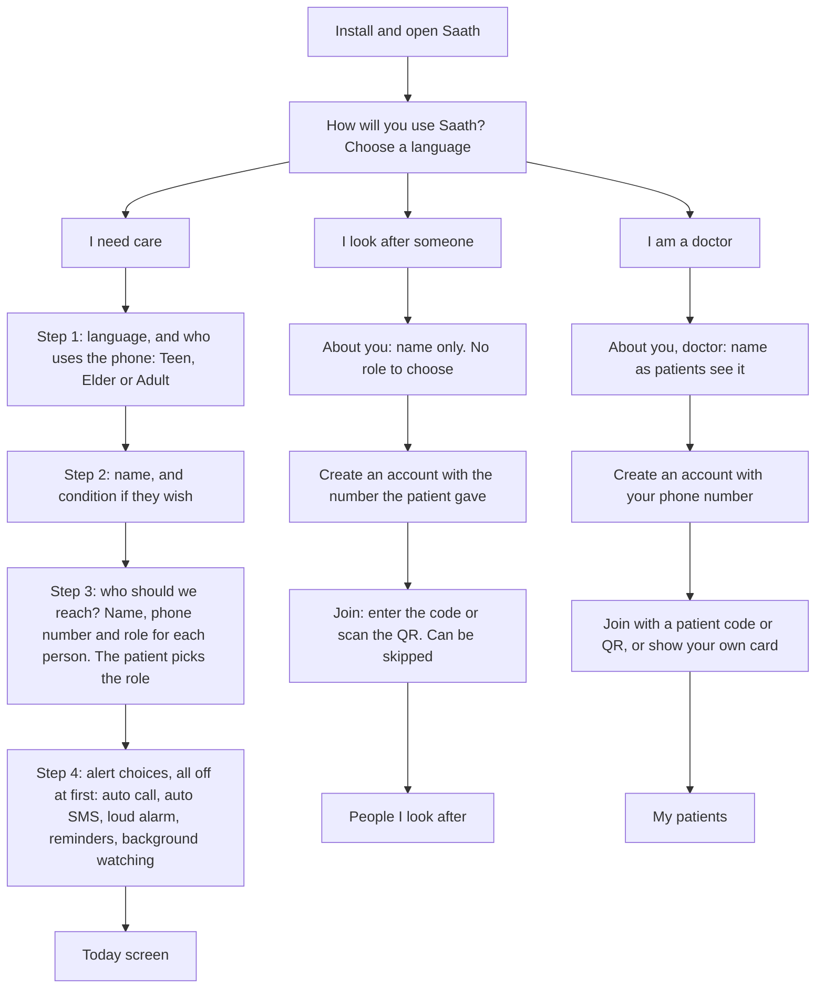

---

## 3. Account sign-in

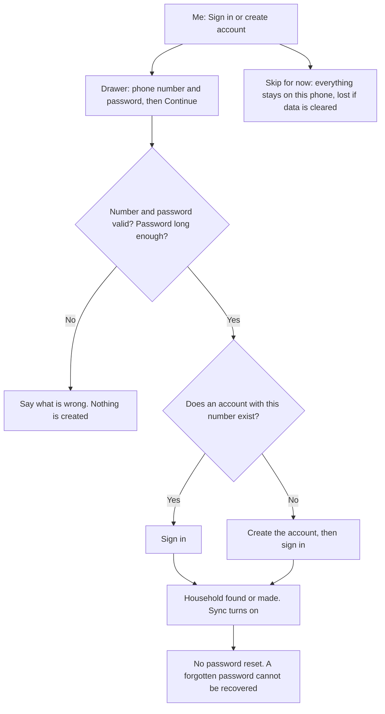

---

## 4. Patient: a day on the Today screen

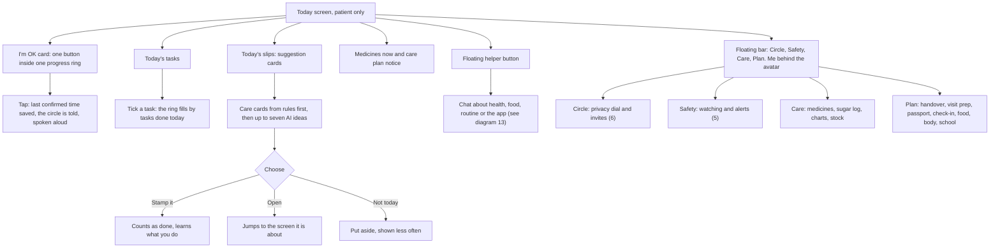

---

## 5. The safety alert process

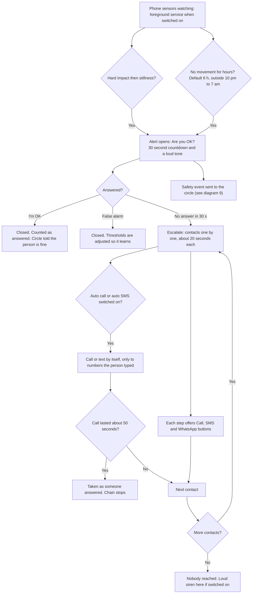

---

## 6. Adding someone to the circle (invite)

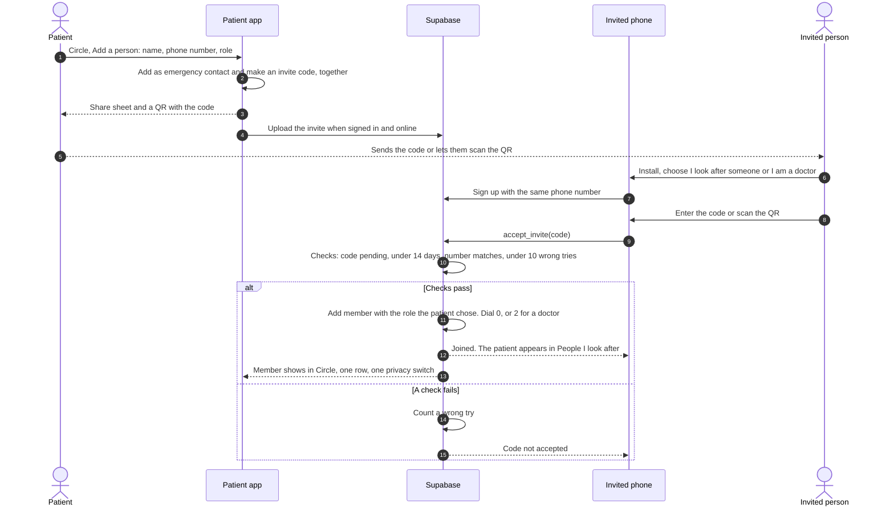

---

## 7. A doctor adds a patient with a card

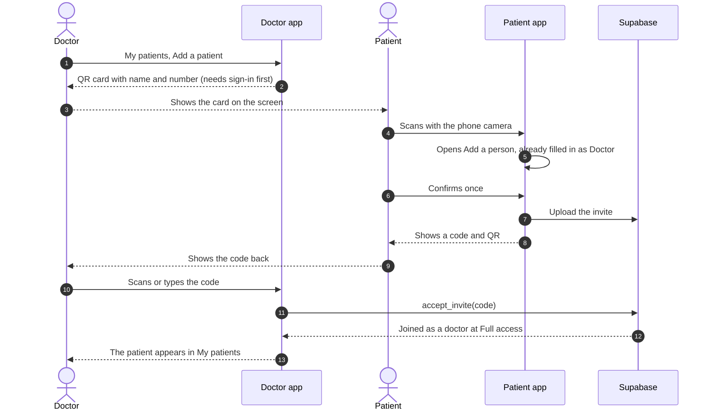

---

## 8. Who sees an event: the privacy dial

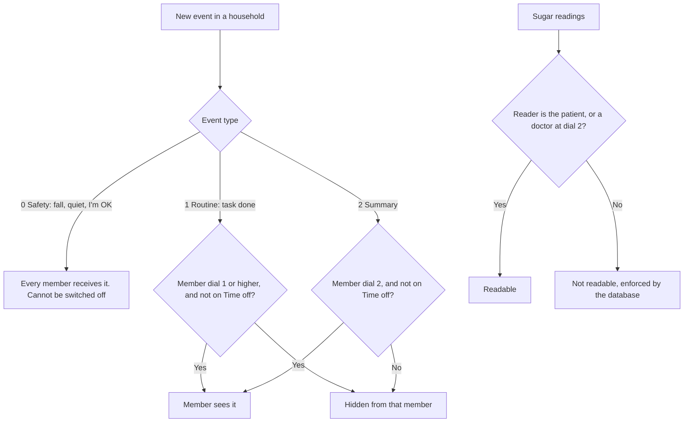

---

## 9. Push notification to the circle

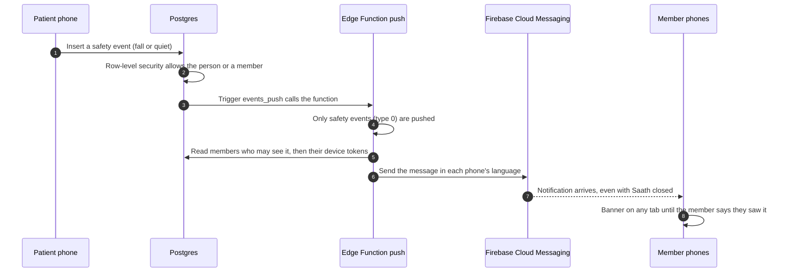

---

## 10. Doctor publishes a care plan

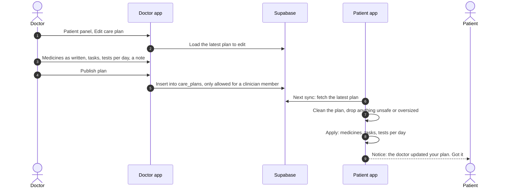

---

## 11. Sugar readings shared with a doctor

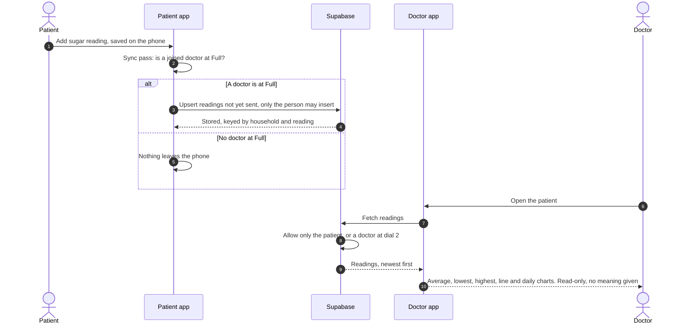

---

## 12. AI suggestion cards

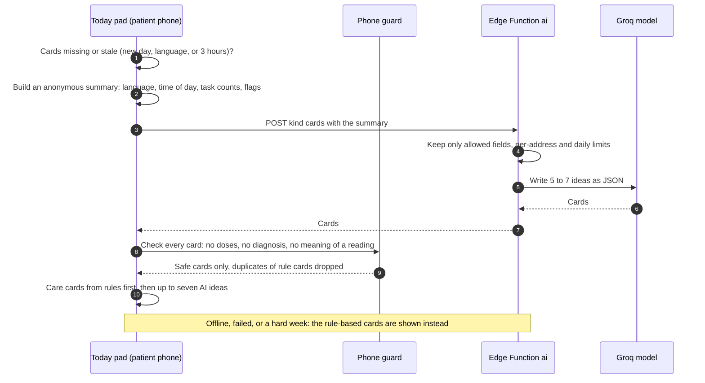

---

## 13. AI helper chat

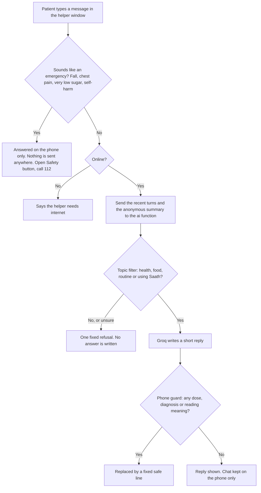

---

## 14. ASHA household visit

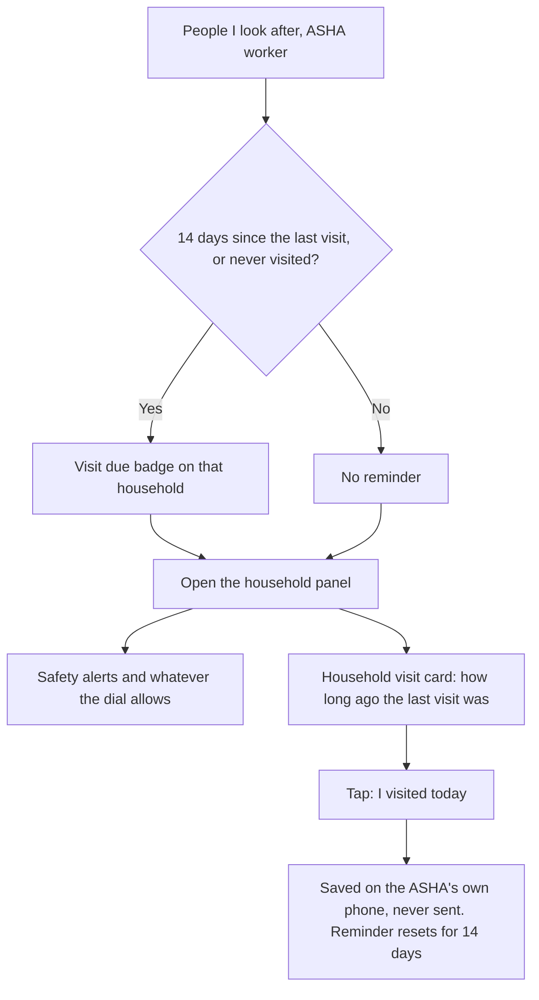

---

## 15. Backend data: tables and links

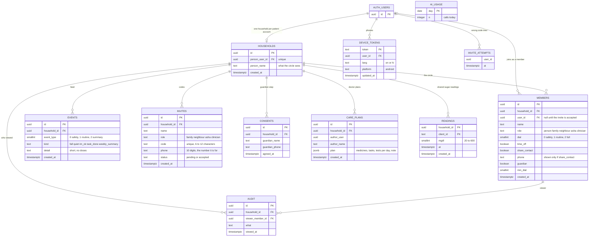

Views the app reads: `my_circles` (the circles a person belongs to, with their role and dial) and `members_public` (the circle, with a phone number only where its owner chose to share it). Functions: `accept_invite(code)` joins a circle, `can_see_event(household, type)` is the single place the privacy dial is decided, `ai_bump(cap)` counts a day's AI calls and says whether the cap is still open.

---

## 16. Who can read and write each table

| Table | Who reads | Who writes |
|---|---|---|
| households | the patient, and any member of it | the patient |
| members | the patient and any member | the patient; each member can change only their own Time off; a new member only through `accept_invite` |
| events | by the privacy dial (`can_see_event`): safety to everyone, routine and summary by dial | the patient writes any type; any member may write a safety event |
| invites | the patient | the patient |
| consents | the patient | the patient |
| audit | the patient | whoever viewed, as themselves |
| device_tokens | the owner of the phone (the push function reads them as the service role) | the owner of the phone, at most 8 phones |
| care_plans | the patient, any clinician member, any member at dial 2 | a clinician member of that household; newest 40 kept |
| readings | the patient, and a clinician member at dial 2 | the patient; newest 2000 kept |
| ai_usage | nobody except the service role | the AI function, through `ai_bump` |
| invite_attempts | nobody (no policy) | `accept_invite` only |

The same privacy dial is also enforced on the phone (`src/logic.js`, `canReceive`), and the two are kept identical on purpose.
